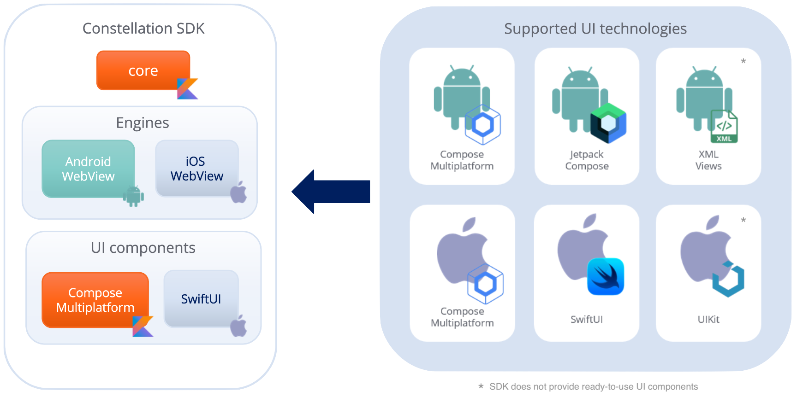
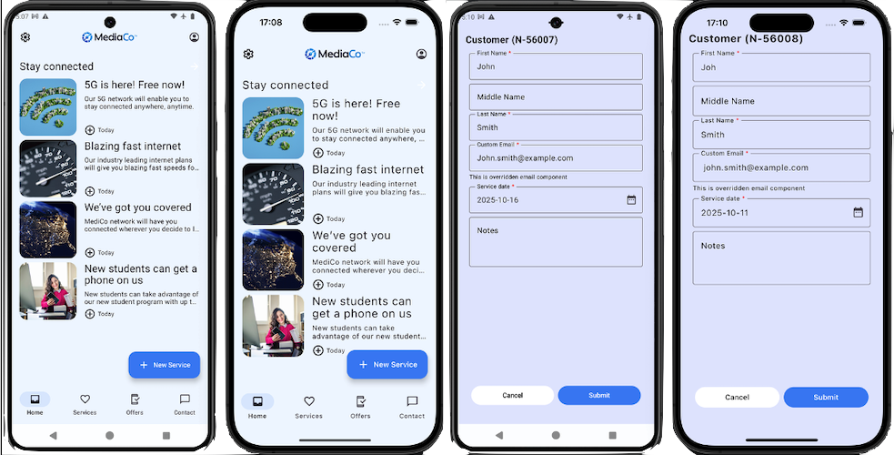
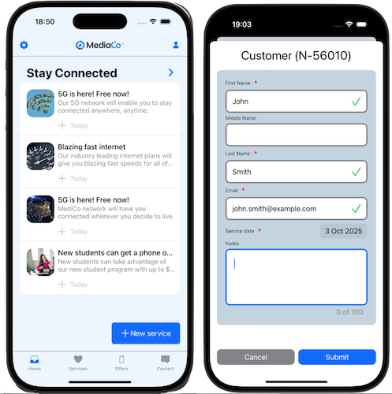

# Pega Constellation Mobile SDK

## Overview

The **Pega Constellation Mobile SDK** is designated for Native Android and iOS applications.
It allows to embed Pega form into existing application with the possibility of using customized UI.

## Contributing and Spec-Driven Development

Feature work and significant behavior changes follow a specification-first workflow. Start with the repository guidance in [CONTRIBUTING.md](CONTRIBUTING.md), [AGENTS.md](AGENTS.md), the [project constitution](.specify/memory/constitution.md), and the [.specify guide](.specify/README.md). GitHub Copilot users can use the installed Spec-Kit skills in [.github/skills](.github/skills) to create a specification, resolve open questions, plan the implementation, break it into tasks, implement the approved scope, and converge or review the result.

Specifications are stored under `specs/<feature>/`. This process is documentation-only scaffolding and does not add GitHub Actions workflows.

## Build requirements

- Gradle `9.4.0` via the checked-in Gradle Wrapper (`./gradlew`)
- JDK 17 or newer to run Gradle
- Android SDK and Android Studio-compatible tooling for Android builds
- Xcode and macOS for iOS frameworks and iOS sample tests

Use the Gradle Wrapper for all project commands. The SDK currently keeps AGP `8.13.2` and Kotlin `2.4.0` unchanged while using Gradle `9.4.0`.

The SDK supports Pega 24, Pega 25, and Pega 26. Pega 26 support starts with Constellation Mobile SDK v4.1.0.

The SDK allows developers to:
- register their implementations for custom components
- provide implementations for Pega components not yet available in the SDK
- register overrides for existing components

It utilizes Constellation JavaScript library and JavaScript components logic.
By default the SDK uses hidden WebView as the JavaScript execution engine.

## Supported Pega use-case

Currently, the SDK supports creating cases of a specified type, opening and processing assignments.

## Supported components Pega 24 & 25
The SDK provides following components out-of-the-box:
- **Simple fields**: 
  - Checkbox, Currency, Date, DateTime, Decimal, Dropdown, Autocomplete, Email, Integer, Phone, RadioButtons, TextArea, Richtext (readonly), TextInput, Time, Url
- **Advanced fields**:
  - EmbeddedData
  - DataReference
    - Single record
      - Displayed as "SimpleTable", "Table", "Dropdown", "Autocomplete", "Cards" - supported
      - Displayed as "Search and select" - not supported
      - Read-Only mode
        - Display as "Read-only field" - supported
    - List of records
      - Displayed as "SimpleTable", "Table", "Combo-box", "Checkbox Group", "Cards" - supported
      - Displayed as "Search and select" - not supported
      - Read-Only mode
        - Displayed as "Read-only field", "Table", "SimpleTable", "Cards" - supported
        - Displayed as "Map" - not supported
    - Many to many - not supported
  - ObjectReference
    - Single record displayed as Autocomplete or Dropdown - supported
    - Multiple records displayed as Combobox/Multiselect - supported
    - Cards, Checkbox Group, Table/SimpleTable, and display-only modes - supported where supplied metadata maps to existing SDK children
    - Search and select, Map, Embedded Insight Table, interactive reference navigation, and review-mode persistence - not supported
  - Details template view
- **Containers**: 
  - Assignment, AssignmentCard, DefaultForm, FlowContainer, Region, RootContainer, View, ViewContainer, Field Group
- **Other**: 
  - ActionButtons, AlertBanner

## Supported components Pega 26

The SDK provides following components out-of-the-box:
- **Simple fields**:
    - Checkbox, Currency, Date, DateTime, Decimal, Dropdown, Autocomplete, Email, Integer, Phone, RadioButtons, TextArea, Richtext (readonly), TextInput, Time, Url
- **Advanced fields**:
    - EmbeddedData 
      - Single record - supported
      - List of records - not supported
    - DataReference
        - Single record
            - Displayed as:
              - "Combobox" (Limited to 1 display field, Show details not supported), 
              - "Dropdown" (Show details not supported), 
              - "Table", "SimpleTable", "Cards" - supported 
            - Displayed as "Search and select" - not supported
            - Read-Only mode
                - Display as "Read-only field" - supported
        - List of records
            - Displayed as "SimpleTable", "Table", "Combobox" (Limited to 1 display field), "Checkbox Group", "Cards" - supported
            - Displayed as "Search and select" - not supported
            - Read-Only mode
                - Displayed as "Read-only field", "Table", "SimpleTable", "Cards" - supported
                - Displayed as "Map" - not supported
        - Many to many - not supported
    - ObjectReference
        - Single record displayed as Autocomplete or Dropdown - supported
        - Multiple records displayed as Combobox/Multiselect - supported
        - Cards, Checkbox Group, Table/SimpleTable, and display-only modes - supported where supplied metadata maps to existing SDK children
        - Search and select, Map, Embedded Insight Table, interactive reference navigation, and review-mode persistence - not supported
    - Details template view
- **Containers**:
    - Assignment, AssignmentCard, DefaultForm, FlowContainer, Region, RootContainer, View, ViewContainer, Field Group
- **Other**:
    - ActionButtons, AlertBanner

## Architecture

The SDK is implemented using Kotlin Multiplatform technology. It allows to share common code between multiple platforms.

The SDK consists of several modules:
- **core**: Contains core SDK logic, configuration and component abstractions. It is platform-independent and shared between all supported platforms.
- **engine**: Contains platform-specific engine implementations, which use Constellation CoreJS library that orchestrates the application logic.
- **samples**: Contains sample applications for Android and iOS platforms.
- **ui**: Contains UI components for supported UI technologies.

The SDK supports following UI technologies:
- **Android**: Compose Multiplatform, Jetpack Compose, XML/Views (*)
- **iOS**: Compose Multiplatform, SwiftUI, UIKit (*)

*\* SDK does not provide out-of-the-box components for these UI technologies*

## How to integrate existing mobile applications with the SDK ##
- [How to integrate Compose Multiplatform App with Constellation SDK](docs/how-to-integrate-compose-multiplatform.md)
- [How to integrate Android Compose App with Constellation SDK](docs/how-to-integrate-android-compose.md)
- [How to integrate IOS Swift App with Constellation SDK](docs/how-to-integrate-ios-swiftui.md)

## Running SDK Sample applications
- [Setting up sample Pega application](docs/setup-sample-pega-app.md)
- [Configuring sample mobile applications](docs/configure-sample-mobile-apps.md)
- [Running Android sample application using Compose Multiplatform](samples/android-cmp-app/README.md)
- [Running iOS sample application using Compose Multiplatform](samples/ios-cmp-app/README.md)
- [Running Android sample application using Jetpack Compose](samples/android-compose-app/README.md)
- [Running iOS sample application using SwiftUI](samples/swiftui-components-app/README.md)

## Screenshots

### Sample apps using Compose Multiplatform (Android and iOS)

### Sample app using SwiftUI (iOS)

## License

Sources of this repository are licensed using [**Apache 2 license**](./LICENSE).
